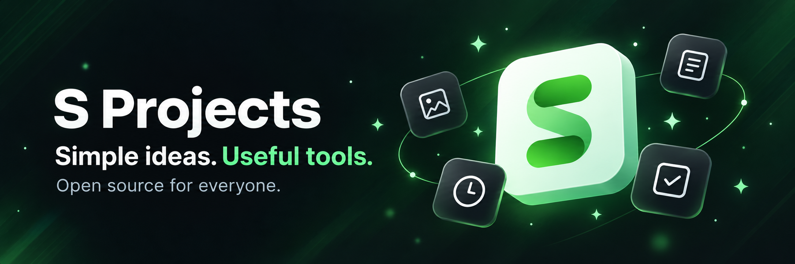

# Hi, I’m Sahil Khan 👋

Automation engineer by profession. I enjoy vibe coding and turning simple ideas into useful tools.

**Open source for everyone.**

## What I’m building

### S Craft
Simple, useful tools for everyday tasks, starting with PDF and image utilities.

## My approach

- Start with a simple idea.
- Make the tool clear and easy to use.
- Share useful work openly.
